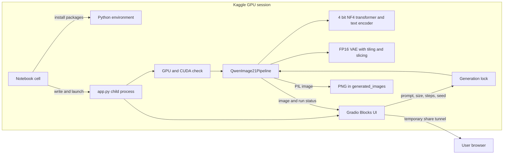
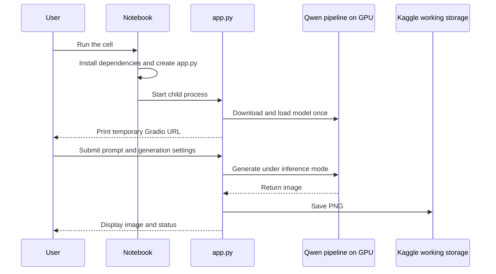

# Runtime Architecture

Qwen Image Studio runs as a single Kaggle notebook cell that bootstraps a temporary inference service and browser UI.

## Components

1. **Notebook bootstrap** removes selected conflicting libraries, installs model and UI dependencies, creates `/kaggle/working/generated_images`, writes `/kaggle/working/app.py`, and streams the child process output.
2. **Model service** checks CUDA and loads `Qwen/Qwen-Image-2.1` using Diffusers' `QwenImage21Pipeline`. The transformer and text encoder use bitsandbytes 4 bit NF4 quantization with FP16 compute. The VAE remains FP16, with tiling and slicing enabled when supported.
3. **Gradio UI** offers prompt, width, height, inference steps, and seed controls. The service clamps dimensions to 512–1024 and steps to 10–40. A nonblocking lock rejects a second concurrent generation.
4. **Output path** saves each image as a timestamp and seed named PNG under `/kaggle/working/generated_images`. This is temporary Kaggle working storage.
5. **Access path** starts Gradio with `share=True`, producing a temporary public tunnel URL. The URL and running app depend on the Kaggle cell and session staying alive.

## Sequence

## Operational boundaries

- Internet is required for dependency installation and model download.
- A CUDA GPU is required. The recorded test used a Tesla T4; actual speed and available VRAM vary.
- The notebook reinstalls selected libraries and installs the latest Diffusers from GitHub, so dependency behavior can change over time.
- There is no built-in prompt moderation or safety filter.
- The temporary share link should be treated as public while active.
