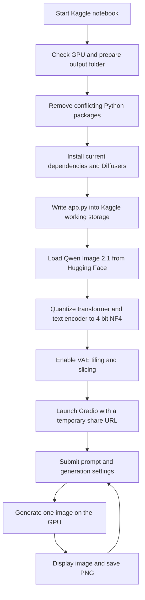

<div align="center">

# Qwen Image Studio

### A Kaggle powered text to image studio for Qwen Image 2.1

Create images from a browser based Gradio interface, using a 4 bit NF4 pipeline tuned for a Kaggle Tesla T4 GPU.

[Quick start](#quick-start) · [How it works](#how-it-works) · [Controls](#using-the-studio) · [Troubleshooting](#troubleshooting)

</div>

---

> **Project format:** one Kaggle notebook cell bootstraps the environment, writes a temporary `app.py`, downloads the model, and launches the web UI. You do not need to upload model weights or a separate app source file.

## At a glance

| | |
| --- | --- |
| Model | [`Qwen/Qwen-Image-2.1`](https://huggingface.co/Qwen/Qwen-Image-2.1) |
| Runtime target | Kaggle Notebook with a CUDA GPU; the recorded run used a Tesla T4 (14.56 GB reported VRAM) |
| Memory strategy | 4 bit NF4 quantization for the transformer and text encoder; FP16 compute; VAE tiling and slicing |
| Interface | Gradio, with a temporary share URL |
| Image output | PNG files in `/kaggle/working/generated_images` |
| Main entry point | [`image-gen-qwen-qwen-image-2-1.ipynb`](image-gen-qwen-qwen-image-2-1.ipynb) |

## What it does

This notebook turns a Kaggle GPU session into a small prompt to image studio. It installs the required Python packages, starts a persistent model process, and presents a Gradio page where you can enter a prompt, choose image dimensions, inference steps, and seed, then view and save the generated image.

The model is loaded once per session. Subsequent generations reuse it. Requests are serialized to avoid overlapping GPU jobs, and the generated image is saved in the Kaggle working directory.

## Quick start

1. Open the notebook on Kaggle. You can upload this `.ipynb` file to a new Kaggle Notebook, or import it from your GitHub repository.
2. In **Notebook options**, enable **Internet** so the cell can install packages and download the model. Select a **GPU** accelerator. The recorded configuration used a Tesla T4.
3. Start a fresh session and run the notebook's single code cell.
4. Keep the cell running while the model initializes. The first run installs dependencies and downloads model files; the example T4 run took about **4.65 minutes** to load the model after dependency setup.
5. When Gradio prints a `gradio.live` URL, open it in your browser. The link is temporary, and the Kaggle cell/session must remain active while you use the UI.
6. Enter a prompt, adjust the controls, and select **Generate Image**. The PNG is also written to `/kaggle/working/generated_images`.

> **Fresh session recommended.** The setup cell deliberately uninstalls and reinstalls several Python packages (including Diffusers, Transformers, Gradio, and Pillow) to establish a compatible stack. It does not uninstall Kaggle's PyTorch packages. Avoid running it in a session where you need those replaced packages for other work.

## Using the studio

- **Image Prompt:** describe the subject, setting, composition, materials, and lighting. The notebook includes example prompts in the UI.
- **Width and Height:** 512–1024 pixels, in increments of 64. Start at 768 × 1024 or smaller on a T4.
- **Inference Steps:** 10–40. More steps take longer; the sample used 25 steps.
- **Seed:** use the same seed and settings to make a generation repeatable where the runtime supports deterministic results.
- **Generate Image:** starts one generation. If one is already running, wait for it to finish.

The interface reports the filename, dimensions, step count, seed, generation time, and current allocated GPU memory. Kaggle's `/kaggle/working` storage is session scoped; download images you want to keep before the session ends.

### Prompting tip

A useful prompt names the subject first, then the scene and visual treatment. For example:

```text
A small glass greenhouse in a misty mountain garden at sunrise,
water droplets on the panes, soft natural light, editorial landscape photography
```

## How it works



### Runtime architecture

- **Notebook orchestrator:** installs dependencies, creates `/kaggle/working/app.py`, launches it as a child process, and streams its logs.
- **Inference service:** checks CUDA, loads `QwenImage21Pipeline`, and configures NF4 quantization for the transformer and text encoder. Compute uses FP16. VAE tiling and slicing reduce memory pressure.
- **Gradio interface:** collects prompt, width, height, steps, and seed; a generation lock allows only one image generation at a time.
- **Artifact storage:** PNGs are saved to `/kaggle/working/generated_images` for the lifetime of the Kaggle session.

## Recorded example run

The attached run log reports the following on a Tesla T4. These are observations from that run, not performance guarantees.

| Run | Settings | Observed time | Reported GPU memory |
| --- | --- | ---: | ---: |
| Model initialization | Qwen Image 2.1, 4 bit NF4 | 4.65 min | 9.99 GB allocated / 10.01 GB reserved |
| Portrait example | 768 × 1024, 25 steps | 92.1 sec | 10.00 GB |
| 1024 square example | 25 steps | 124.9 sec | 10.00 GB |

Generation time varies with resolution, steps, GPU availability, and the Kaggle environment. The attached log also contains test prompts that produced a Diffusers `invalid value encountered in cast` warning; the app still reported success. Treat that warning as a potentially invalid output and inspect generated files rather than assuming every prompt produces a valid image.

## Requirements and environment

- Kaggle account and a notebook session with **Internet enabled** and a **CUDA GPU** selected.
- The notebook's recorded environment used Python 3.12 and a Tesla T4.
- Internet access is needed for package installation and the first model download. A Hugging Face token is optional for public model access, but may help avoid unauthenticated Hub rate limits.
- GPU memory needs depend on resolution and the actual Kaggle accelerator. The notebook is configured for a T4 class GPU; larger settings can run out of memory.

The notebook installs `transformers>=5.17.0`, `accelerate`, `bitsandbytes`, `safetensors`, `huggingface_hub`, `pillow==11.3.0`, and `gradio`; it installs Diffusers directly from its GitHub repository. Because some versions are unpinned, a future upstream release may change compatibility. For reproducible long term runs, pin and validate a known-good dependency set.

## Troubleshooting

| Problem | What to try |
| --- | --- |
| `CUDA GPU was not detected` | Enable a GPU accelerator in Kaggle Notebook options, then restart the session and rerun the cell. |
| Package or model download fails | Check that Internet is enabled. Retry in a fresh session; optionally configure a Hugging Face token using Kaggle Secrets. |
| CUDA out of memory | Reduce width and height (try 512 × 512), lower inference steps, and restart the session if memory remains occupied. |
| Gradio URL does not appear | Wait for model loading to finish and inspect the cell output for the first exception. Keep the cell running. |
| Share URL stops working | The `gradio.live` tunnel is temporary and depends on the notebook session. Rerun the cell to create a new one. |
| Image output looks corrupted or triggers a cast warning | Try a different prompt and smaller dimensions; inspect the saved PNG. A success message alone may not catch invalid pixel values. |

## Safety, privacy, and licensing

- This notebook does **not** implement prompt moderation or an output safety filter. Use it responsibly, and do not use it to create or distribute abusive, exploitative, or non-consensual imagery.
- `share=True` exposes the Gradio app through a public, temporary URL. Anyone with the link may be able to access it while the session is active. Do not enter private or sensitive prompts, and stop the notebook when finished.
- Model weights are downloaded from Hugging Face at runtime and are governed by the [Qwen Image 2.1 Research License](https://huggingface.co/Qwen/Qwen-Image-2.1). Review that license and the applicable Kaggle terms before use or redistribution.
- This repository does not include a project `LICENSE` file. The model license does not automatically license this notebook or generated images; choose and add a code license only if you have the rights and want to grant one.

## Repository layout

```text
imagegen-kaggle/
├── image-gen-qwen-qwen-image-2-1.ipynb  # Kaggle setup and launch workflow
├── README.md                            # Setup, usage, architecture, and run notes
├── ARCHITECTURE.md                      # System flow and runtime details
└── .gitignore                           # Excludes generated files and secrets
```

## Before publishing to GitHub

1. Review the notebook outputs and clear them in Jupyter/Kaggle if you do not want to publish execution logs, prompts, or temporary Gradio URLs. The attached output contains a temporary public link; it will expire, but it is best not to keep it in a public notebook.
2. Commit the notebook itself, not the generated `app.py`, model weights, Hugging Face cache, or generated images. The notebook recreates the app on Kaggle.
3. Add a project license only after deciding how you want the notebook/code licensed. Keep the model's separate license attribution clear.
4. In the GitHub repository settings, add a short description such as: **“Kaggle T4 text-to-image studio using Qwen Image 2.1, NF4 quantization, and Gradio.”**

---

<div align="center">

Built as an experimental notebook workflow · Powered by Qwen Image 2.1 · Runs on Kaggle GPU

</div>
